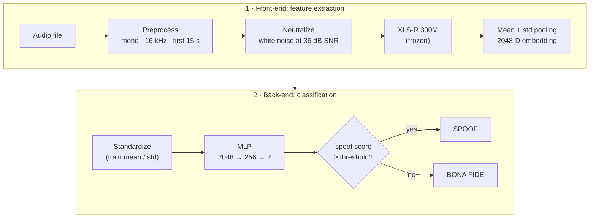

<div align="center">

# XLSR-MLP · Spanish Speech Anti-Spoofing

**Detect synthetic (AI-generated) Spanish speech with frozen XLS-R 300M embeddings and a lightweight MLP.**

[](https://www.python.org/)
[](https://pytorch.org/)
[](https://huggingface.co/facebook/wav2vec2-xls-r-300m)
[](https://huggingface.co/datasets/purdueviperlab/HISPASpoof)
[](#results)

</div>

---

XLSR-MLP tells **bona fide** (real) speech apart from **spoofed** (synthetic, TTS / voice-cloned) speech in Spanish. A frozen [XLS-R 300M](https://huggingface.co/facebook/wav2vec2-xls-r-300m) model turns each recording into a 2048-dimensional embedding, and a compact MLP of about 525K parameters (2 MB) classifies it. The classifier was trained on the detection subset of [HISPASpoof](https://huggingface.co/datasets/purdueviperlab/HISPASpoof), which covers six Spanish accents and six modern zero-shot TTS systems.

## Contents

- [How it works](#how-it-works)
- [Quick start](#quick-start)
- [Using it from Python](#using-it-from-python)
- [Results](#results)
- [Training your own model](#training-your-own-model)
- [Repository structure](#repository-structure)
- [Limitations](#limitations)
- [Acknowledgements and citation](#acknowledgements-and-citation)

## How it works



1. **Feature extraction (front-end).** Each recording is converted to mono at 16 kHz and cut to its first 15 seconds. It is then *neutralized* by adding white noise at a fixed 36 dB SNR, which masks the original noise floor so the classifier cannot rely on recording conditions instead of synthesis artifacts. The pre-trained `facebook/wav2vec2-xls-r-300m` model produces frame-level representations, and their **mean and standard deviation** over the valid (non-padded) frames are concatenated into a **2048-D vector**.
2. **Classification (back-end).** A compact MLP (`2048 → 256 → 2`, 525,570 parameters) with `BatchNorm1d`, `LeakyReLU`, `Dropout(0.3)` and a class-weighted cross-entropy loss to handle the class imbalance.
3. **Threshold calibration.** The decision threshold is set at the *Equal Error Rate* (EER) operating point of the **validation** set, never on the data that is reported, to avoid optimistic bias.

## Quick start

### 1. Install

```bash
git clone https://github.com/nicolas-aguilar-f/XLSR-MLP.git
cd XLSR-MLP
python -m venv .venv
source .venv/bin/activate          # Windows: .venv\Scripts\activate
pip install -r requirements.txt
```

> [!TIP]
> `pip install -r requirements.txt` installs whatever PyTorch build is the default for your platform. For GPU inference, first install `torch` and `torchaudio` with CUDA support by following the [official instructions](https://pytorch.org/get-started/locally/). The CPU works fine too, just slower.

### 2. Classify an audio file

```bash
python predict.py path/to/audio.wav
```

The first run downloads the XLS-R 300M weights from Hugging Face (about 1.2 GB); later runs use the local cache. You can pass several files at once:

```bash
python predict.py real_voice.wav cloned_voice.mp3
```

```text
Prediction           Spoof score   File
BONA FIDE (real)          0.0001   real_voice.wav
SPOOF (synthetic)         0.9996   cloned_voice.mp3

Files with a spoof score >= 0.5969 (EER threshold of the validation set) are flagged as spoof.
```

The **spoof score** is the softmax output of the MLP for the synthetic class (0 = surely real, 1 = surely synthetic). Files that score at or above the threshold stored in the checkpoint are flagged as spoof.

### Options

| Option | Default | Description |
| --- | --- | --- |
| `audio` (positional) | | One or more audio files to classify |
| `--checkpoint PATH` | `models/mlp_antispoofing_spanish.pth` | MLP checkpoint to use |
| `--device DEVICE` | `auto` | `auto`, `cpu`, `cuda` or `cuda:N` |
| `--seed N` | `1234` | Seed of the neutralization noise, so the same file always gets the same score |
| `--json` | off | Print one JSON object per file instead of a table |

```bash
python predict.py audio.wav --json
```

```json
{"file": "audio.wav", "label": "spoof", "spoof_score": 0.9995986819267273, "threshold": 0.5969346761703491}
```

The script exits with code `0` when every file was processed and `1` when some file could not be read.

### Supported audio

Any format that [libsndfile](https://libsndfile.github.io/libsndfile/formats.html) can read: **WAV, FLAC, MP3, OGG/Vorbis, Opus**, and more. Any sample rate and channel count are accepted: audio is resampled to 16 kHz and stereo is downmixed to mono automatically. Only the **first 15 seconds** are analyzed, the same as in training. For formats such as M4A/AAC, convert first:

```bash
ffmpeg -i input.m4a output.wav
```

## Using it from Python

```python
from xlsr_mlp import SpoofDetector

detector = SpoofDetector("models/mlp_antispoofing_spanish.pth")   # device="auto"

result = detector.predict("audio.wav")
print(result["label"], result["spoof_score"])                    # e.g. spoof 0.9996

score = detector.score("other.flac")                             # just the score
```

`SpoofDetector` loads XLS-R once, so you can reuse it for as many files as you need.

## Results

| Split | EER | Decision threshold |
| --- | --- | --- |
| HISPASpoof validation | **0.02 %** | 0.5969 |

Both values are stored in the released checkpoint (`eer_val` and `umbral`).

## Training your own model

### 1. Get the dataset

Download [HISPASpoof](https://huggingface.co/datasets/purdueviperlab/HISPASpoof) and locate its `detection` folder:

```text
detection/
├── protocols/
│   ├── train_metadata.csv      # columns: filename, label (0 = bona fide, 1 = spoof)
│   ├── val_metadata.csv
│   └── test_metadata.csv
├── train/
├── val/
└── test/
```

Any other dataset works as long as it follows the same layout.

### 2. Extract the XLS-R embeddings

```bash
python extract_features.py --data-dir /path/to/HISPASpoof/detection --output-dir features
```

This writes `features/train.npz`, `features/val.npz` and `features/test.npz`, each with the embeddings `X (N, 2048)`, the labels `y` and the `filenames`. A GPU is strongly recommended for this step.

### 3. Train the MLP

```bash
python train_mlp.py --features-dir features --output models/my_model.pth
```

| Hyperparameter | Value |
| --- | --- |
| Epochs | 7 |
| Batch size | 256 |
| Optimizer | Adam, learning rate 1e-3, weight decay 1e-4 |
| LR schedule | Cosine annealing |
| Loss | Cross-entropy weighted by inverse class frequency |
| Seed | 1234 |

All of them can be changed from the command line (`python train_mlp.py --help`). At the end, the script computes the EER threshold on the validation set and saves everything to the checkpoint.

### 4. Use the new model

```bash
python predict.py audio.wav --checkpoint models/my_model.pth
```

<details>
<summary><b>Checkpoint format</b></summary>

The checkpoint is a dictionary saved with `torch.save`. Its keys keep the Spanish names the released model was saved with, so every checkpoint produced by `train_mlp.py` is interchangeable with it.

| Key | Content |
| --- | --- |
| `modelo` | `state_dict` of the MLP |
| `media` | Train-set mean of the 2048-D embeddings (NumPy `float32`) |
| `desv` | Train-set standard deviation of the embeddings (NumPy `float32`) |
| `umbral` | Decision threshold: EER point on the validation set |
| `eer_val` | Validation EER, in % |

Because it stores NumPy arrays, the checkpoint has to be loaded with `torch.load(..., weights_only=False)`. Only load checkpoints from sources you trust.

</details>

## Repository structure

```text
XLSR-MLP/
├── predict.py                          # Classify audio files (command line)
├── xlsr_mlp.py                         # Shared code: audio loading, neutralization,
│                                       #   XLS-R embedder, MLP and SpoofDetector
├── extract_features.py                 # Training step 1: XLS-R embeddings -> .npz
├── train_mlp.py                        # Training step 2: MLP training + threshold calibration
├── models/
│   └── mlp_antispoofing_spanish.pth    # Released checkpoint (~2 MB)
├── requirements.txt
└── README.md
```

Feature extraction, training and inference all use the same preprocessing code in `xlsr_mlp.py`, so the embeddings computed at inference time match the ones the MLP was trained on.

## Limitations

- **Spanish only.** The model was trained on Spanish speech and has not been evaluated on other languages.
- **Known generators.** The synthetic training data comes from six TTS systems (XTTS-v1, XTTS-v2, YourTTS, Fish Speech, ElevenLabs and F5-TTS). Unseen generators, voice conversion or heavy post-processing (telephone channels, strong compression, background music) may lower the accuracy.
- **Not a calibrated probability.** The spoof score is a softmax output, and the threshold is the EER point of the HISPASpoof validation set. For other data or a different balance between false alarms and misses, you may want to recalibrate it.
- **First 15 seconds.** Longer recordings are truncated, so content after the 15-second mark is not analyzed.
- **A screening tool.** Use its output as one piece of evidence, not as a definitive forensic verdict.

## Acknowledgements and citation

- **HISPASpoof** by Purdue's VIPER Lab ([paper](https://arxiv.org/abs/2509.09155), [dataset](https://huggingface.co/datasets/purdueviperlab/HISPASpoof)), released under CC BY-SA 4.0.
- **XLS-R** by Meta AI ([paper](https://arxiv.org/abs/2111.09296), [model](https://huggingface.co/facebook/wav2vec2-xls-r-300m)), released under Apache 2.0.

If you use this work, please also cite them:

```bibtex
@article{risques2025hispaspoof,
  title   = {{HISPASpoof}: A New Dataset For Spanish Speech Forensics},
  author  = {Risques, Maria and Bhagtani, Kratika and Yadav, Amit Kumar Singh and Delp, Edward J.},
  journal = {arXiv preprint arXiv:2509.09155},
  year    = {2025}
}

@article{babu2021xlsr,
  title   = {{XLS-R}: Self-supervised Cross-lingual Speech Representation Learning at Scale},
  author  = {Babu, Arun and Wang, Changhan and Tjandra, Andros and Lakhotia, Kushal and Xu, Qiantong and Goyal, Naman and Singh, Kritika and von Platen, Patrick and Saraf, Yatharth and Pino, Juan and Baevski, Alexei and Conneau, Alexis and Auli, Michael},
  journal = {arXiv preprint arXiv:2111.09296},
  year    = {2021}
}
```
